# STUDI KASUS MODEL FUZZY, CLUSTERING FUZZY, DAN ESTIMASI PARAMETER

## Prediksi Dini Indeks Standar Pencemar Udara (ISPU) Hari Berikutnya di DKI Jakarta Menggunakan Takagi-Sugeno Orde-1 Berbasis Fuzzy C-Means dan Hybrid Learning

| Atribut | Keterangan |
| --- | --- |
| Mata Kuliah | Komputasi Lunak |
| Program Studi | Informatika — Fakultas Sains dan Matematika |
| Universitas | Universitas Diponegoro |
| Nama Mahasiswa | Menza Isaiah Tampubolon |
| NIM | 24060124140138 |
| Kelas | [Kelas] |
| Dosen Pengampu | [Nama Dosen Pengampu] |
| Tahun | 2026 |

---


# 2. PENDAHULUAN


## 2.1 Latar Belakang

Kualitas udara ambien di Provinsi DKI Jakarta merupakan persoalan lingkungan dan kesehatan masyarakat yang krusial. Aktivitas transportasi padat, emisi industri, serta dinamika meteorologi perkotaan menyebabkan fluktuasi harian konsentrasi polutan seperti partikulat kasar (PM10), partikulat halus (PM2.5), sulfur dioksida (SO2), karbon monoksida (CO), ozon (O3), dan nitrogen dioksida (NO2). Sejak diberlakukannya Peraturan Menteri Lingkungan Hidup dan Kehutanan (Permen LHK) Nomor P.14/MENLHK/SETJEN/KUM.1/7/2020 [7], parameter PM2.5 secara resmi dimasukkan ke dalam perhitungan Indeks Standar Pencemar Udara (ISPU) harian yang dipantau oleh lima Stasiun Pemantau Kualitas Udara (SPKU) Dinas Lingkungan Hidup DKI Jakarta.

Pentingnya penelitian prediksi dini ISPU hari berikutnya (ISPU(t+1)) terletak pada fungsinya sebagai sistem peringatan dini (early warning system). Apabila pemangku kebijakan dan masyarakat hanya mengetahui status mutu udara pada hari berjalan, langkah mitigasi seperti imbauan pembatasan aktivitas luar ruang atau rekayasa lalu lintas sering terlambat dilakukan. Memprediksi skor ISPU besok berdasarkan profil enam polutan hari ini memungkinkan tindakan preventif sebelum episode polusi Tinggi (Tidak Sehat) terjadi.

Pendekatan konvensional dalam pemantauan dan peramalan kualitas udara memiliki dua kelemahan mendasar. Pertama, klasifikasi konvensional menggunakan ambang batas tegas (crisp threshold)—misalnya skor 50 dikategorikan Baik sedangkan skor 51 langsung menjadi Sedang—yang tidak merepresentasikan transisi risiko kesehatan secara kontinu. Kedua, model statistik linear global seperti Regresi Linear Berganda (OLS) maupun model persistensi (ISPU(t+1) = ISPU(t)) kesulitan menangkap hubungan non-linear serta interaksi antarpolutan yang berbeda antara hari bersih dan hari berpolusi tinggi.

Untuk mengatasi hal tersebut, penelitian ini memilih Model Fuzzy Takagi-Sugeno Orde-1 [2]. Model fuzzy mampu memodelkan ketidakpastian dan perubahan bertahap antar-rezim polusi melalui himpunan fuzzy [1], sementara keluaran berupa kombinasi linear variabel masukan pada Takagi-Sugeno Orde-1 memberikan kemampuan aproksimasi fungsi non-linear yang jauh lebih akurat dibandingkan keluaran konstanta maupun himpunan linguistik statis.

Penentuan fungsi keanggotaan dan basis aturan fuzzy secara subjektif dari pakar sering kali tidak optimal untuk data multivariat 6 dimensi. Oleh karena itu, digunakan metode Clustering Fuzzy C-Means (FCM) [3] untuk mempartisi ruang data secara objektif dan berbasis data. Berbeda dari hard clustering (seperti K-Means) yang memaksa setiap hari pengamatan masuk secara mutlak ke satu kelompok, FCM memberikan derajat keanggotaan kontinu di antara 0 dan 1 sehingga mencerminkan hari-hari transisi polusi secara lebih realistis.

Meskipun pusat dan lebar fungsi keanggotaan awal dapat diturunkan langsung dari FCM, sistem fuzzy yang hanya mengandalkan inisialisasi clustering belum menjamin kesalahan prediksi minimum. Karena itu, diperlukan tahap Estimasi Parameter secara sistematis menggunakan pendekatan Hybrid Learning (Jang, 1993) [5] yang menggabungkan Regularized Least Squares Estimation (LSE) untuk menyetel parameter konsekuen linear secara eksak dan Gradient Descent untuk menyempurnakan parameter premis Gaussian (pusat dan lebar kurva keanggotaan) hingga model menjadi lebih representatif.


## 2.2 Rumusan Masalah


1. Bagaimana membangun model fuzzy Takagi-Sugeno Orde-1 untuk memprediksi skor dan kategori ISPU hari berikutnya (ISPU(t+1)) di DKI Jakarta dari 6 parameter polutan harian?
2. Bagaimana proses pembentukan kelompok data polusi udara DKI Jakarta secara objektif menggunakan metode clustering Fuzzy C-Means (FCM) dan bagaimana validitas jumlah clusternya?
3. Bagaimana estimasi parameter premis Gaussian dan konsekuen linear dilakukan menggunakan metode Hybrid Learning (Regularized LSE dan Gradient Descent) agar model lebih representatif?
4. Bagaimana performa model fuzzy yang dihasilkan dibandingkan dengan model pra-estimasi serta baseline konvensional (Persistence dan Regresi Linear OLS)?


## 2.3 Tujuan Studi Kasus


- Membangun sistem prediksi dini berbasis logika fuzzy Takagi-Sugeno Orde-1 untuk memprediksi nilai kontinu dan kategori mutu udara ISPU(t+1) DKI Jakarta.
- Menerapkan algoritma Fuzzy C-Means (FCM) disertai evaluasi Partition Coefficient (PC), Partition Entropy (PE), dan Xie-Beni Index (XB) guna memperoleh struktur cluster data yang objektif.
- Melakukan estimasi parameter premis dan konsekuen fuzzy secara sistematis melalui studi ablasi 3 tahap (Pra-estimasi Orde-0, Regularized LSE, dan Hybrid Learning).
- Mengimplementasikan keseluruhan model dalam modul Python teruji, notebook Google Colab interaktif, serta aplikasi GUI berbasis Streamlit.


# 3. TINJAUAN PUSTAKA


## 3.1 Konsep Dasar Logika Fuzzy

Logika fuzzy pertama kali diperkenalkan oleh Lotfi A. Zadeh (1965) [1] sebagai perluasan dari teori himpunan klasik (crisp set). Jika himpunan klasik hanya mengenal keanggotaan biner {0, 1}, maka himpunan fuzzy A pada semesta pembicaraan X didefinisikan melalui fungsi keanggotaan μ_A(x) ∈ [0, 1] yang menyatakan derajat kebenaran keanggotaan suatu nilai x terhadap himpunan A. Konsep ini memungkinkan representasi variabel linguistik (seperti Polusi Rendah atau Polusi Tinggi) secara matematis.

Pada penelitian ini digunakan fungsi keanggotaan Gaussian untuk setiap variabel masukan j ∈ {1,...,D} pada aturan ke-i:


```text
μ_ij(x_j) = exp( - (x_j - v_ij)^2 / (2 * σ_ij^2) )
```

di mana v_ij menyatakan pusat fungsi keanggotaan dan σ_ij menyatakan lebar (simpangan baku) kurva. Operasi logika AND antar-anteseden pada satu aturan menggunakan T-norm perkalian aljabar (product operator) untuk menghasilkan kekuatan penyulutan (firing strength) w_i(x) = ∏_{j=1}^D μ_ij(x_j), yang kemudian dinormalisasi menjadi w̄_i(x) = w_i(x) / ∑_{r=1}^c w_r(x). Inferensi agregat mengubah himpunan hasil aturan menjadi nilai keluaran numerik tunggal (defuzzifikasi).


## 3.2 Model Fuzzy Takagi-Sugeno Orde-1

Model fuzzy Takagi-Sugeno (TSK) diperkenalkan oleh Takagi dan Sugeno (1985) [2]. Berbeda dengan model Mamdani yang menggunakan himpunan fuzzy pada bagian konsekuen, model Takagi-Sugeno Orde-1 menggunakan fungsi linear dari variabel masukan sebagai konsekuen setiap aturan:


```text
Aturan i: IF x_1 is A_i1 AND ... AND x_D is A_iD  THEN  f_i(x) = p_i0 + p_i1*x_1 + ... + p_iD*x_D
```

Keluaran akhir sistem diperoleh melalui defuzzifikasi rata-rata terbobot (weighted average): ŷ(x) = ∑_{i=1}^c w̄_i(x) * f_i(x). Kelebihan utama model Takagi-Sugeno Orde-1 adalah efisiensi komputasi karena tidak memerlukan proses defuzzifikasi integral yang mahal, fleksibilitas tinggi dalam memodelkan sistem non-linear kompleks melalui interpolasi mulus antar-bidang linear lokal, serta kompatibilitas langsung dengan metode estimasi parameter berbasis aljabar linear (Least Squares Estimation) dan optimasi gradien [2], [5].


## 3.3 Clustering Fuzzy (Fuzzy C-Means)

Clustering adalah teknik pembelajaran tak terawasi (unsupervised learning) untuk mengelompokkan data ke dalam cluster berdasarkan kemiripan fitur. Pada hard clustering (seperti K-Means), setiap titik data dimiliki secara eksklusif oleh satu cluster saja. Sebaliknya, pada fuzzy clustering yang dirumuskan oleh Bezdek (1981) melalui algoritma Fuzzy C-Means (FCM) [3], setiap titik data x_k memiliki derajat keanggotaan u_ik ∈ [0, 1] terhadap setiap cluster i dengan kendala partisi ∑_{i=1}^c u_ik = 1.

Algoritma FCM meminimalkan fungsi objektif berbobot berikut:


```text
J_m(U, V) = ∑_{k=1}^N ∑_{i=1}^c (u_ik)^m * ||x_k - v_i||_2^2 ,   dengan m = 2.0
```

Pembaruan derajat keanggotaan u_ik dan pusat cluster v_i pada setiap iterasi dihitung melalui:


```text
u_ik = 1 / ∑_{r=1}^c ( ||x_k - v_i||_2 / ||x_k - v_r||_2 )^(2/(m-1)) ,    v_i = ( ∑_{k=1}^N (u_ik)^m x_k ) / ( ∑_{k=1}^N (u_ik)^m )
```

Proses iterasi dihentikan apabila kriteria konvergensi ||U^(t) - U^(t-1)||_∞ < 10^-5 terpenuhi. Untuk menilai kualitas partisi secara objektif digunakan tiga indeks validitas: Partition Coefficient (PC = (1/N)∑∑ u_ik^2, lebih tinggi lebih baik), Partition Entropy (PE = -(1/N)∑∑ u_ik ln u_ik, lebih rendah lebih baik), serta Xie-Beni Index (XB) [4] yang membandingkan kekompakan intra-cluster terhadap jarak minimum antar-pusat cluster (lebih rendah lebih baik).


## 3.4 Estimasi Parameter dengan Hybrid Learning

Dalam kerangka ANFIS/Takagi-Sugeno adaptif yang diperkenalkan Jang (1993) [5], setiap lintasan pelatihan Hybrid Learning terbagi menjadi dua fase dalam satu epoch: (1) Forward Pass, di mana parameter premis (v_ij, σ_ij) dianggap tetap sehingga keluaran prediksi menjadi linear terhadap vektor parameter konsekuen θ = [p_i0, ..., p_iD]. Untuk mencegah multikolinearitas dan overfitting pada data nyata, digunakan Regularized Least Squares Estimation (Ridge LSE): θ̂ = (A^T A + λI)^(-1) A^T y; (2) Backward Pass, di mana parameter konsekuen θ dianggap tetap dan kesalahan prediksi dirambatkan balik menggunakan Gradient Descent untuk memperbarui v_ij dan log(σ_ij). Berbagai studi terkini (mis. Karki, 2023 [6]) juga menunjukkan efektivitas integrasi model neuro-fuzzy adaptif dalam memprediksi indeks kualitas udara perkotaan.


# 4. METODOLOGI


## 4.1 Sumber dan Prapemrosesan Dataset

Penelitian ini menggunakan data historis nyata Indeks Standar Pencemar Udara (ISPU) Provinsi DKI Jakarta tahun 2021 yang bersumber dari Dinas Lingkungan Hidup Provinsi DKI Jakarta (Portal Satu Data Jakarta) [7] untuk lima stasiun SPKU: DKI1 (Bunderan HI), DKI2 (Kelapa Gading), DKI3 (Jagakarsa), DKI4 (Lubang Buaya), DKI5 (Kebon Jeruk) Jakarta Barat. Dari total 1825 baris observasi mentah selama 12 bulan (1 Januari – 31 Desember 2021), dilakukan perbaikan pergeseran header pada berkas resmi bulan Juni dan Juli 2021, penghapusan 308 baris dengan nilai kosong/tidak terbaca sensor (terutama awal Januari sebelum sensor PM2.5 beroperasi penuh di semua SPKU), sehingga diperoleh 1517 baris bersih.

Selanjutnya, untuk membentuk masalah prediksi hari berikutnya (t -> t+1) yang bebas kebocoran data (zero data leakage), setiap observasi hari ke-t dipasangkan dengan nilai ISPU maksimum hari ke-(t+1) secara ketat di dalam stasiun yang sama dan hanya apabila selisih tanggal tepat 1 hari. Proses ini menghasilkan 1444 pasangan data berurutan. Data dibagi secara kronologis (time-series split) tanpa pengacakan menjadi Data Latih (1065 data, 2021-01-01 s.d. 2021-09-11), Data Validasi (175 data, 2021-09-12 s.d. 2021-11-05), dan Data Uji (204 data, 2021-11-06 s.d. 2021-12-30). Normalisasi Z-score dihitung hanya dari statistik Data Latih.


## 4.2 Perancangan Sistem Fuzzy

Rancangan arsitektur sistem prediksi dini ISPU meliputi:


- Input Sistem: Vektor 6 sub-indeks polutan harian pada hari ke-t, yaitu x_t = [PM10, PM2.5, SO2, CO, O3, NO2]_t.
- Output Sistem: Prediksi skor kontinu ISPU hari berikutnya ŷ_{t+1} beserta pemetaan kategori mutu udara resmi Permen LHK No. P.14/2020 [7]: Baik (0–50), Sedang (51–100), Tidak Sehat (101–200), Sangat Tidak Sehat (201–300), dan Berbahaya (>300).
- Basis Aturan (Rule Base): Dibentuk otomatis sebanyak c* = 2 aturan fuzzy Takagi-Sugeno Orde-1 dari hasil partisi FCM. Contoh representasi aturan linguistik:


```text
R1: IF PM10 Rendah AND PM2.5 Rendah AND SO2 Rendah AND CO Rendah AND O3 Rendah AND NO2 Rendah THEN f1(x) = p10 + sum(p1j * xj)
R2: IF PM10 Tinggi AND PM2.5 Tinggi AND SO2 Tinggi AND CO Tinggi AND O3 Tinggi AND NO2 Tinggi THEN f2(x) = p20 + sum(p2j * xj)
```


## 4.3 Rancangan Evaluasi dan Studi Ablasi

Untuk membuktikan kontribusi setiap komponen secara ilmiah, performa model dievaluasi dengan metrik RMSE, MAE, R², MAPE, Akurasi Kategori, dan Akurasi ±1 Kategori melalui perbandingan 5 skenario: (1) Persistence Baseline (ŷ_{t+1} = ISPU_t), (2) Regresi Linear Berganda (OLS), (3) Tahap 0: FCM + Sugeno Orde-0 (tanpa estimasi konsekuen linear), (4) Tahap 1: FCM + Takagi-Sugeno Orde-1 + Regularized LSE, serta (5) Tahap 2: FCM + Takagi-Sugeno Orde-1 + Hybrid Learning (LSE + Gradient Descent).


# 5. PEMBAHASAN DAN HASIL


## 5.1 Karakteristik Dataset ISPU DKI Jakarta

Tabel 5.1 merangkum statistik deskriptif dari 1444 pasangan observasi harian DKI Jakarta. Polutan PM2.5 memiliki rata-rata sub-indeks tertinggi (78.36 ± 23.12), diikuti PM10 (52.88). Distribusi komposisi kategori target menunjukkan dominasi kategori Sedang (1095 hari / 75.8%), diikuti Tidak Sehat (230 hari / 15.9%) dan Baik (119 hari / 8.2%).


**Tabel 5.1 Statistik Deskriptif Variabel Input dan Target (N = 1.444)**

| Variabel | N | Rata-rata | Std Dev | Min | Median | Maks |
| --- | --- | --- | --- | --- | --- | --- |
| PM10 (Sub-Indeks t) | 1444 | 52.88 | 14.78 | 15 | 54 | 179 |
| PM2.5 (Sub-Indeks t) | 1444 | 78.36 | 23.12 | 16 | 78 | 174 |
| SO2 (Sub-Indeks t) | 1444 | 35.67 | 12.57 | 4 | 35 | 82 |
| CO (Sub-Indeks t) | 1444 | 11.94 | 4.78 | 2 | 11 | 43 |
| O3 (Sub-Indeks t) | 1444 | 31.11 | 14.84 | 8 | 27 | 151 |
| NO2 (Sub-Indeks t) | 1444 | 20.53 | 9.47 | 3 | 19 | 65 |
| ISPU Max Hari Ini (t) | 1444 | 79.32 | 22.36 | 20 | 79 | 179 |
| Target ISPU Besok (t+1) | 1444 | 79.29 | 22.24 | 20 | 79 | 179 |


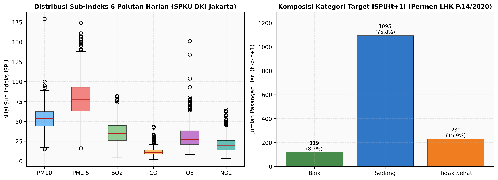
*Gambar 5.1 Distribusi sub-indeks 6 polutan dan komposisi kategori target ISPU(t+1).*


## 5.2 Penentuan Jumlah Cluster Optimal dan Hasil Fuzzy C-Means

Eksperimen sapuan jumlah cluster c ∈ {2, 3, 4, 5, 6} pada Data Latih (Tabel 5.2) menunjukkan bahwa nilai Partition Coefficient (PC) tertinggi (0.5938), Partition Entropy (PE) terendah (0.5934), serta kesalahan validasi LSE terendah (Val RMSE = 13.6816) dicapai pada c* = 2. Penyempurnaan parameter regularisasi Ridge melalui Validation RMSE Hybrid Learning selanjutnya memilih λ* = 50.0 (Val RMSE = 13.2142).


**Tabel 5.2 Hasil Evaluasi Validitas Cluster FCM dan Validasi RMSE**

| c | PC | PE | Xie-Beni (XB) | J_m | Iterasi | λ LSE | Val RMSE |
| --- | --- | --- | --- | --- | --- | --- | --- |
| 2 | 0.5938 | 0.5934 | 0.7590 | 3101.32 | 44 | 25.0 | 13.6816 |
| 3 | 0.4636 | 0.9110 | 0.6684 | 2020.45 | 50 | 5.0 | 14.2194 |
| 4 | 0.3775 | 1.1562 | 0.8322 | 1502.45 | 84 | 1.0 | 14.4295 |
| 5 | 0.3251 | 1.3428 | 0.7323 | 1193.52 | 72 | 1.0 | 14.4994 |
| 6 | 0.2869 | 1.4996 | 0.8544 | 989.39 | 97 | 1.0 | 14.9706 |


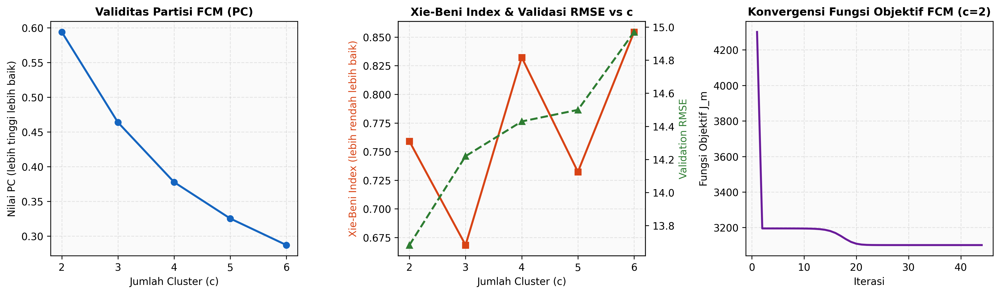
*Gambar 5.2 Kurva validitas partisi FCM (PC, XB, Val RMSE) dan konvergensi fungsi objektif J_m.*

Pada c* = 2, FCM konvergen dalam 44 iterasi menghasilkan dua pusat cluster terurut yang sangat interpretatif (Tabel 5.3): Cluster 1: Polusi Rendah (Dom. PM2.5) (485 hari latih, rata-rata target ISPU berikutnya 69.48) dan Cluster 2: Polusi Tinggi (Dom. PM2.5) (580 hari latih, rata-rata target ISPU berikutnya 92.61). Tabel 5.4 memperlihatkan contoh derajat keanggotaan fuzzy u_ik pada lima observasi awal di mana jumlah derajat keanggotaan setiap baris selalu bernilai 1.0000.


**Tabel 5.3 Pusat Cluster FCM dalam Skala Sub-Indeks ISPU Asli**

| Cluster | N | PM10 | PM2.5 | SO2 | CO | O3 | NO2 | Rata2 ISPU(t+1) |
| --- | --- | --- | --- | --- | --- | --- | --- | --- |
| Cluster 1: Polusi Rendah (Dom. PM2.5) | 485 | 45.46 | 67.51 | 29.86 | 11.02 | 28.55 | 17.53 | 69.48 |
| Cluster 2: Polusi Tinggi (Dom. PM2.5) | 580 | 62.15 | 94.18 | 38.89 | 13.05 | 33.24 | 22.97 | 92.61 |


**Tabel 5.4 Contoh Matriks Derajat Keanggotaan FCM (u_ik)**

| Tanggal | Stasiun | PM10 / PM2.5 | u_C1 | u_C2 | Dominan |
| --- | --- | --- | --- | --- | --- |
| 2021-01-01 | DKI1 | 38 / 53 | 0.8329 | 0.1671 | C1 |
| 2021-01-01 | DKI3 | 43 / 56 | 0.7662 | 0.2338 | C1 |
| 2021-01-02 | DKI1 | 27 / 46 | 0.7330 | 0.2670 | C1 |
| 2021-01-02 | DKI3 | 58 / 86 | 0.5322 | 0.4678 | C1 |
| 2021-01-03 | DKI1 | 44 / 58 | 0.8181 | 0.1819 | C1 |


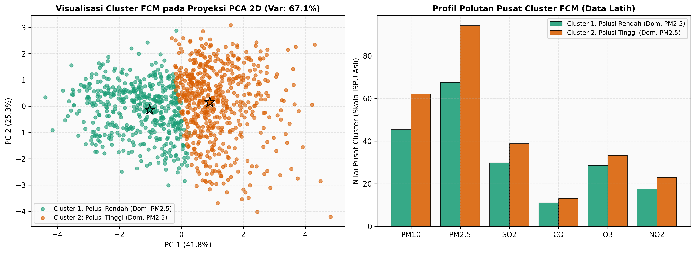
*Gambar 5.3 Proyeksi PCA 2D hasil clustering FCM dan profil polutan tiap pusat cluster.*


## 5.3 Hasil Estimasi Parameter Premis dan Konsekuen

Tahap Hybrid Learning dijalankan dengan early stopping berbasis Data Validasi dan mencapai titik terbaik pada epoch ke-7 (Val RMSE = 13.214, Train RMSE = 16.460). Tabel 5.5 membandingkan parameter Gaussian (pusat v_ij dan lebar σ_ij dalam skala ISPU asli) sebelum dan sesudah optimasi Gradient Descent, sedangkan Tabel 5.6 menampilkan koefisien konsekuen linear Takagi-Sugeno Orde-1 hasil Regularized LSE.


**Tabel 5.5 Parameter Premis Gaussian Sebelum (FCM Awal) dan Sesudah Hybrid Learning**

| Aturan | Polutan | v Awal | v Hybrid | σ Awal | σ Hybrid |
| --- | --- | --- | --- | --- | --- |
| C1 | PM10 | 45.46 | 41.59 | 13.22 | 9.69 |
| C1 | PM2.5 | 67.51 | 51.79 | 19.22 | 10.22 |
| C1 | SO2 | 29.86 | 28.06 | 10.34 | 6.06 |
| C1 | CO | 11.02 | 11.66 | 4.54 | 3.22 |
| C1 | O3 | 28.55 | 29.84 | 14.30 | 10.68 |
| C1 | NO2 | 17.53 | 15.20 | 8.28 | 5.01 |
| C2 | PM10 | 62.15 | 55.26 | 10.83 | 17.68 |
| C2 | PM2.5 | 94.18 | 85.31 | 20.48 | 30.40 |
| C2 | SO2 | 38.89 | 35.93 | 11.29 | 16.08 |
| C2 | CO | 13.05 | 12.09 | 4.68 | 6.13 |
| C2 | O3 | 33.24 | 30.89 | 14.66 | 18.33 |
| C2 | NO2 | 22.97 | 21.38 | 8.31 | 11.27 |


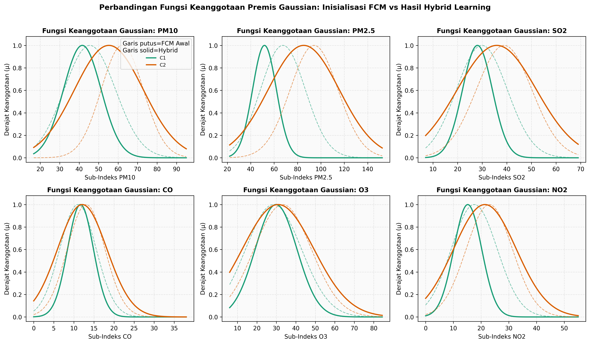
*Gambar 5.4 Perbandingan kurva fungsi keanggotaan Gaussian sebelum dan sesudah Hybrid Learning.*


**Tabel 5.6 Koefisien Konsekuen Linear Takagi-Sugeno Orde-1 (Input Terstandarisasi)**

| Aturan | Bias p0 | p_PM10 | p_PM2.5 | p_SO2 | p_CO | p_O3 | p_NO2 |
| --- | --- | --- | --- | --- | --- | --- | --- |
| Aturan 1 | 6.722 | -8.884 | -7.397 | -5.170 | -4.438 | -0.534 | -6.019 |
| Aturan 2 | 79.421 | 0.078 | 13.457 | 0.765 | -4.171 | 0.977 | 2.123 |


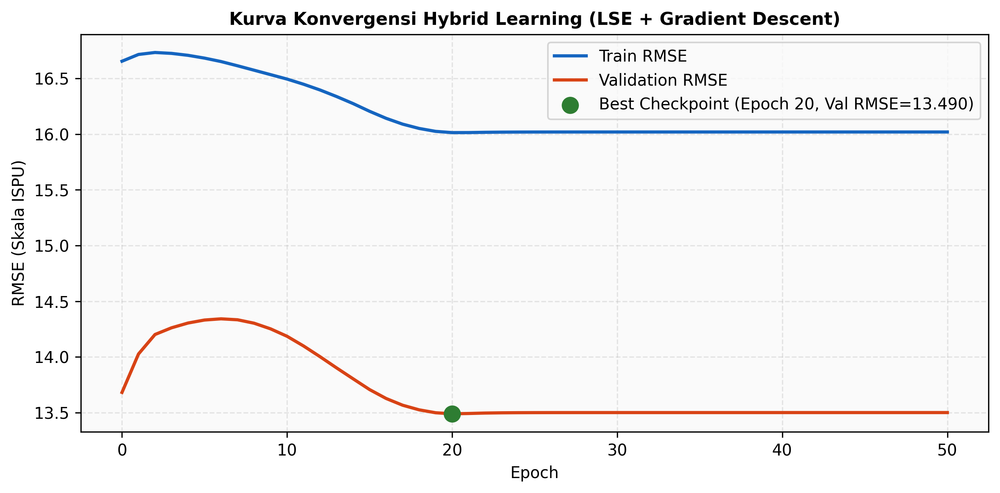
*Gambar 5.5 Kurva konvergensi Train RMSE dan Validation RMSE selama pelatihan Hybrid Learning.*


## 5.4 Simulasi Inferensi Fuzzy dan Hasil Studi Ablasi

Tabel 5.7 menampilkan penelusuran inferensi langkah demi langkah pada tiga skenario uji nyata (Baik, Sedang, dan Polusi Tinggi). Tabel 5.8 dan 5.9 menyajikan perbandingan performa kuantitatif pada Data Validasi dan Data Uji.


**Tabel 5.7 Simulasi Inferensi Fuzzy TSK-1 pada Tiga Kasus Nyata Test Set**

| Skenario | Lokasi & Tgl | Input Polutan | Bobot w̄ | Konsekuen f_i | Prediksi | Aktual | Galat |
| --- | --- | --- | --- | --- | --- | --- | --- |
| Kondisi Udara Baik | DKI1 (2021-11-29) | PM10=23, PM2.5=28, SO2=30, CO=7, O3=12, NO2=5 | w̄1=0.025 | w̄2=0.975 | f1=60.45 | f2=48.13 | 48.43 (Baik) | 50 (Baik) | 1.57 |
| Kondisi Sedang Harian | DKI5 (2021-12-11) | PM10=32, PM2.5=54, SO2=21, CO=5, O3=31, NO2=15 | w̄1=0.335 | w̄2=0.665 | f1=45.10 | f2=67.75 | 60.16 (Sedang) | 60 (Sedang) | 0.16 |
| Episode Polusi Tinggi | DKI4 (2021-11-17) | PM10=60, PM2.5=99, SO2=39, CO=10, O3=19, NO2=14 | w̄1=0.000 | w̄2=1.000 | f1=2.42 | f2=89.51 | 89.51 (Sedang) | 106 (Tidak Sehat) | 16.49 |


**Tabel 5.8 Hasil Studi Ablasi & Baseline pada Data Validasi (12 Sep – 5 Nov 2021)**

| Model | RMSE | MAE | R² | MAPE | Akurasi Kat. | Akurasi ±1 Kat. |
| --- | --- | --- | --- | --- | --- | --- |
| Persistence (ISPU_t) | 15.520 | 11.971 | -0.0513 | 15.06% | 84.00% | 100.00% |
| Regresi Linear (OLS) | 14.069 | 11.379 | 0.1361 | 15.21% | 85.14% | 100.00% |
| Tahap 0: FCM + Sugeno-0 | 14.468 | 11.893 | 0.0865 | 16.08% | 88.57% | 100.00% |
| Tahap 1: FCM + TSK-1 (LSE) | 15.008 | 11.556 | 0.0171 | 14.23% | 85.14% | 100.00% |
| Tahap 2: FCM + TSK-1 (Hybrid) | 13.214 | 10.423 | 0.2380 | 13.60% | 86.86% | 100.00% |


**Tabel 5.9 Hasil Studi Ablasi & Baseline pada Data Uji (6 Nov – 30 Des 2021)**

| Model | RMSE | MAE | R² | MAPE | Akurasi Kat. | Akurasi ±1 Kat. |
| --- | --- | --- | --- | --- | --- | --- |
| Persistence (ISPU_t) | 21.520 | 16.255 | -0.2259 | 27.02% | 70.10% | 99.51% |
| Regresi Linear (OLS) | 19.275 | 14.447 | 0.0165 | 26.17% | 78.43% | 99.51% |
| Tahap 0: FCM + Sugeno-0 | 22.385 | 17.745 | -0.3265 | 34.16% | 76.47% | 100.00% |
| Tahap 1: FCM + TSK-1 (LSE) | 20.684 | 15.419 | -0.1326 | 27.11% | 75.49% | 100.00% |
| Tahap 2: FCM + TSK-1 (Hybrid) | 18.966 | 14.085 | 0.0478 | 24.76% | 74.51% | 99.51% |


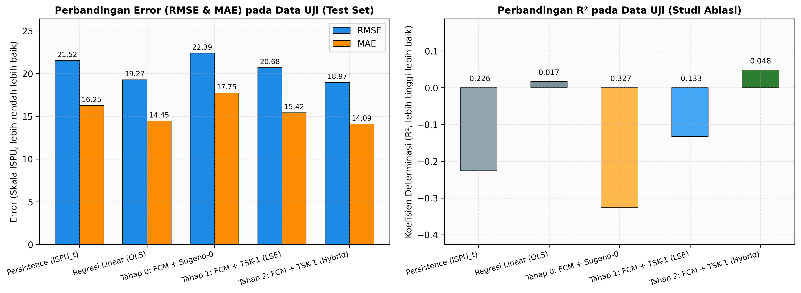
*Gambar 5.6 Perbandingan RMSE, MAE, dan R² seluruh model pada studi ablasi Data Uji.*


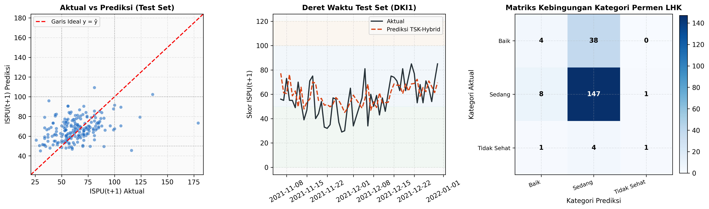
*Gambar 5.7 Grafik aktual vs prediksi, deret waktu stasiun DKI1, dan matriks kebingungan kategori pada Data Uji.*


# 6. IMPLEMENTASI PROGRAM


## 6.1 Arsitektur Kode Python dan Google Colab

Seluruh implementasi dibangun menggunakan Python 3.12.6 dengan pustaka NumPy, Pandas, SciPy, Scikit-Learn, Matplotlib, dan Streamlit. Struktur kode dipisahkan secara modular: src/data_loader.py (pembersihan data dan pasangan t -> t+1 bebas kebocoran), src/fcm.py (Fuzzy C-Means dan metrik validitas PC/PE/XB), src/sugeno_hybrid.py (Takagi-Sugeno Orde-1, LSE, dan Hybrid Learning beserta verifikasi gradien numerik), src/evaluation.py (metrik regresi dan pemetaan Permen LHK), serta src/visualization.py.


```python
class TakagiSugenoHybrid:
    def fit_lse(self, X_train, y_train, ridge_lambda=50.0):
        _, _, w_bar = self._forward_premise(X_train)
        X_aug = np.hstack([np.ones((len(X_train), 1)), X_train])
        A = (w_bar[:, :, None] * X_aug[:, None, :]).reshape(len(X_train), -1)
        theta = np.linalg.solve(A.T @ A + ridge_lambda * np.eye(A.shape[1]), A.T @ y_train)
        self.consequents_ = theta.reshape(self.n_clusters, self.n_features + 1)

    def fit_hybrid(self, X_tr, y_tr, X_va, y_va, epochs=150, lr=0.05):
        # Forward: LSE eksak pada konsekuen; Backward: Gradient Descent pada (v_ij, log sigma_ij)
        ...
```

Notebook interaktif lengkap yang dapat dijalankan ulang satu klik di Google Colab tersedia pada berkas notebooks/ISPU_Fuzzy_FCM_Hybrid.ipynb dan tautan Google Colab berikut: https://colab.research.google.com/drive/16HuDWxvMATIR4tWVLtUFNNe_x_u4qZWg


## 6.2 Dokumentasi GUI Interaktif (Streamlit)

Sebagai nilai tambah aplikasi pengguna, dibangun GUI web interaktif berbasis Streamlit (app.py) yang memenuhi seluruh kriteria fungsional: (1) menerima input manual 6 parameter polutan maupun preset data nyata Jakarta, (2) menampilkan peta cluster PCA 2D dan derajat keanggotaan FCM, (3) memvisualisasikan kurva fungsi keanggotaan Gaussian lengkap dengan posisi input pengguna, (4) merinci tabel inferensi fuzzy dan kontribusi tiap aturan, serta (5) menyajikan keputusan akhir prediksi skor ISPU(t+1), badge kategori warna Permen LHK, dan rekomendasi mitigasi kesehatan.


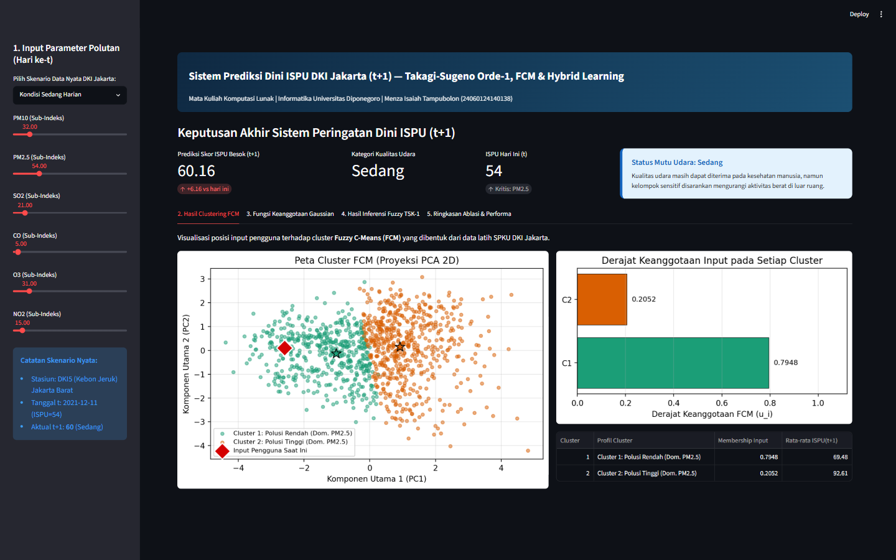
*Gambar 6.1 Tampilan utama GUI Streamlit: input sidebar, kartu keputusan akhir, dan visualisasi clustering FCM.*


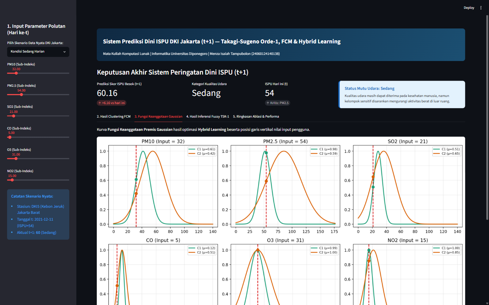
*Gambar 6.2 Tab fungsi keanggotaan Gaussian interaktif dengan garis penanda nilai input pengguna.*


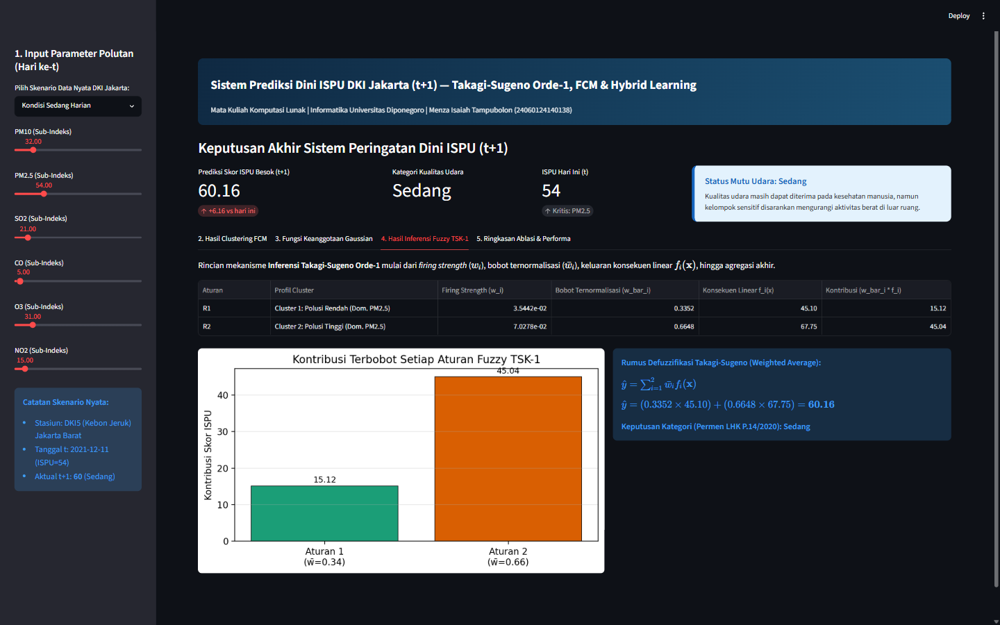
*Gambar 6.3 Tab rincian inferensi Takagi-Sugeno Orde-1, kontribusi aturan, dan persamaan defuzzifikasi.*


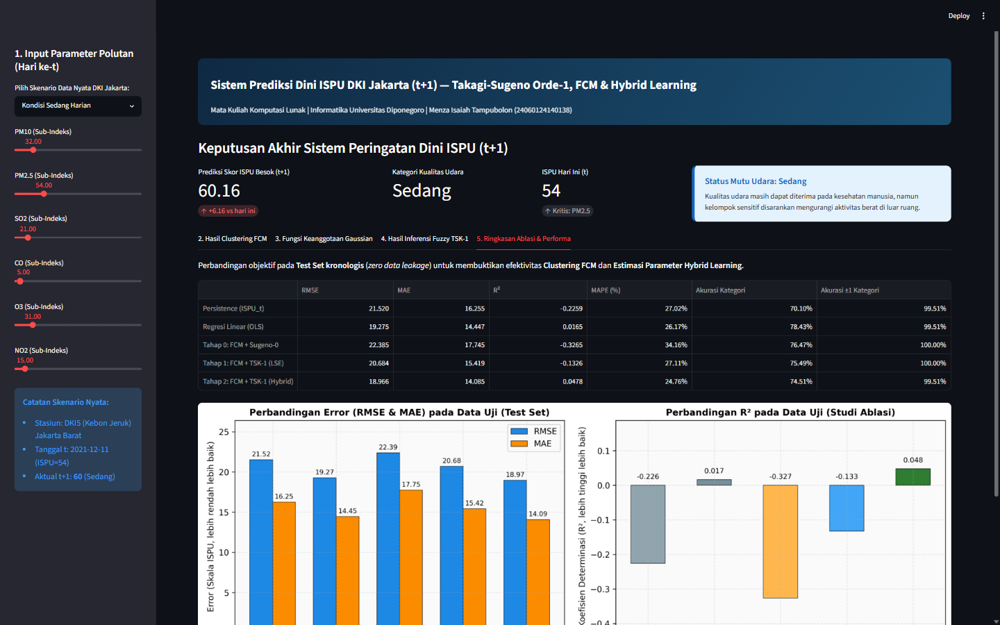
*Gambar 6.4 Tab ringkasan evaluasi studi ablasi dan perbandingan metrik pada Data Uji.*


# 7. ANALISIS HASIL


## 7.1 Interpretasi Hasil Clustering dan Parameter Model

Partisi optimal c* = 2 memisahkan dinamika udara Jakarta secara alami menjadi rezim Polusi Rendah (pusat PM2.5 = 67.51, rata-rata target ISPU besok 69.48) dan rezim Polusi Tinggi (pusat PM2.5 = 94.18, rata-rata target ISPU besok 92.61). Setelah proses Hybrid Learning, pusat fungsi keanggotaan C1 pada PM2.5 bergeser dari 67.51 menjadi 51.79 dengan lebar kurva yang lebih tajam (σ dari 19.22 menjadi 10.22), sedangkan C2 memperluas cakupan σ dari 20.48 menjadi 30.40. Hal ini menunjukkan bahwa Hybrid Learning memfokuskan aturan pertama pada kondisi transisi udara bersih dan menyerahkan variasi lonjakan polusi tinggi pada aturan kedua. Pada tabel konsekuen linear (Tabel 5.6), koefisien terbesar secara konsisten berada pada p_PM2.5 (-7.397 dan 13.457), menegaskan bahwa konsentrasi PM2.5 hari ini merupakan prediktor terkuat bagi ISPU hari berikutnya.


## 7.2 Analisis Dampak Estimasi Parameter dan Perbandingan Baseline

Hasil studi ablasi membuktikan dampak krusial dari pemilihan orde model dan estimasi parameter secara sistematis. Pada Data Uji, model pra-estimasi Tahap 0 (FCM + Sugeno Orde-0) menghasilkan RMSE 22.385 (R² = -0.3265) karena output konstan tidak mampu mengikuti perubahan gradien polutan harian. Penambahan konsekuen linear melalui Regularized LSE (Tahap 1) langsung menurunkan RMSE Uji menjadi 20.684, dan penyempurnaan premis melalui Hybrid Learning (Tahap 2) menekan galat lebih jauh hingga mencapai RMSE Uji terbaik sebesar 18.966, MAE 14.085, dan MAPE 24.76%—mengungguli baseline Persistence (RMSE 21.520) maupun Regresi Linear OLS (RMSE 19.275). Pada Data Validasi, keunggulan Hybrid Learning juga terlihat jelas dengan RMSE 13.214 (R² = 0.2380) dibandingkan OLS (14.069) dan Persistence (15.520).

Dari sisi klasifikasi kategori Permen LHK pada Data Uji, model mencapai Akurasi Kategori 74.51% dan Akurasi ±1 Kategori 99.51%. Penurunan nilai R² pada periode Uji (November–Desember 2021) dibandingkan Data Latih (R² = 0.4664) dan Validasi (R² = 0.2380) disebabkan oleh pergeseran distribusi musiman (seasonal distribution shift): periode November–Desember merupakan puncak musim penghujan di Jakarta yang memicu pencucian polutan (rain washout) secara mendadak sehingga proporsi hari berkategori Baik meningkat drastis.


## 7.3 Kelebihan, Kelemahan, dan Potensi Pengembangan


- Kelebihan Model: Transparan dan mudah diinterpretasi melalui aturan IF-THEN serta bobot penyulutan; tahan terhadap outlier berkat perhitungan log-space; mampu mengungguli model linear global maupun persistensi pada metrik error kontinu.
- Kelemahan Model: Hanya bergantung pada 6 variabel polutan historis hari ke-t tanpa variabel meteorologi eksternal, sehingga lonjakan/penurunan mendadak akibat hujan deras atau perubahan arah angin belum dapat dijelaskan sepenuhnya.
- Potensi Pengembangan: Integrasi data meteorologi BMKG (curah hujan, kecepatan angin, suhu, dan kelembaban relatif), penggunaan jendela lag multi-hari (t-2, t-1, t), serta eksperimen optimasi metaheuristik seperti PSO-ANFIS [6] atau model hibrid musiman multi-tahun.


# 8. KESIMPULAN DAN SARAN


## 8.1 Kesimpulan


1. Model fuzzy Takagi-Sugeno Orde-1 berhasil dibangun dan diimplementasikan untuk memprediksi skor serta kategori mutu udara ISPU(t+1) DKI Jakarta menggunakan 1.444 pasangan pengamatan harian resmi dari 5 stasiun SPKU tahun 2021 tanpa kebocoran data.
2. Metode clustering Fuzzy C-Means (FCM) secara objektif mempartisi data latih menjadi c* = 2 cluster optimal berdasarkan nilai PC tertinggi (0.5938) dan Validation RMSE terendah, yang merepresentasikan kondisi Polusi Rendah dan Polusi Tinggi dengan dominansi polutan PM2.5.
3. Estimasi parameter dua-tahap menggunakan Hybrid Learning (Regularized LSE λ* = 50 dan Gradient Descent dengan early stopping) menyempurnakan ketajaman fungsi keanggotaan Gaussian serta menyetel koefisien konsekuen linear secara optimal pada epoch ke-7.
4. Studi ablasi membuktikan perbaikan performa yang konsisten: pada Data Uji, TSK-1 Hybrid mencapai RMSE terbaik (18.966), MAE (14.085), dan MAPE (24.76%), mengungguli Tahap 0 Sugeno-0 (RMSE 22.385), Persistence (RMSE 21.520), dan Regresi Linear OLS (RMSE 19.275), dengan akurasi ±1 kategori sebesar 99.51%.


## 8.2 Saran

Untuk penelitian lanjutan disarankan menggabungkan dataset ISPU lintas tahun (2021–2025) bersama data meteorologi harian BMKG (curah hujan, kecepatan angin, dan kelembaban udara) agar model mampu menangkap pergeseran musiman antara musim kemarau dan musim penghujan di DKI Jakarta secara lebih presisi.


# 9. DAFTAR PUSTAKA


[1] L. A. Zadeh, "Fuzzy sets," Information and Control, vol. 8, no. 3, pp. 338–353, Jun. 1965.

[2] T. Takagi and M. Sugeno, "Fuzzy identification of systems and its applications to modeling and control," IEEE Transactions on Systems, Man, and Cybernetics, vol. SMC-15, no. 1, pp. 116–132, Jan.–Feb. 1985.

[3] J. C. Bezdek, Pattern Recognition with Fuzzy Objective Function Algorithms. New York, NY, USA: Plenum Press, 1981.

[4] X. L. Xie and G. Beni, "A validity measure for fuzzy clustering," IEEE Transactions on Pattern Analysis and Machine Intelligence, vol. 13, no. 8, pp. 841–847, Aug. 1991.

[5] J.-S. R. Jang, "ANFIS: Adaptive-network-based fuzzy inference system," IEEE Transactions on Systems, Man, and Cybernetics, vol. 23, no. 3, pp. 665–685, May–Jun. 1993.

[6] A. Karki, "Improved ANFIS model based on confinement optimized PSO to predict the air quality of Delhi, India," in Proc. 2023 IEEE International Conference on Fuzzy Systems (FUZZ), 2023, doi: 10.1109/FUZZ52849.2023.10309676.

[7] Kementerian Lingkungan Hidup dan Kehutanan Republik Indonesia, Peraturan Menteri LHK Nomor P.14/MENLHK/SETJEN/KUM.1/7/2020 tentang Indeks Standar Pencemar Udara, Jakarta, 2020; serta Dinas Lingkungan Hidup Provinsi DKI Jakarta, Data Indeks Standar Pencemar Udara (ISPU) di Provinsi DKI Jakarta Tahun 2021, Portal Satu Data Jakarta (satudata.jakarta.go.id).
